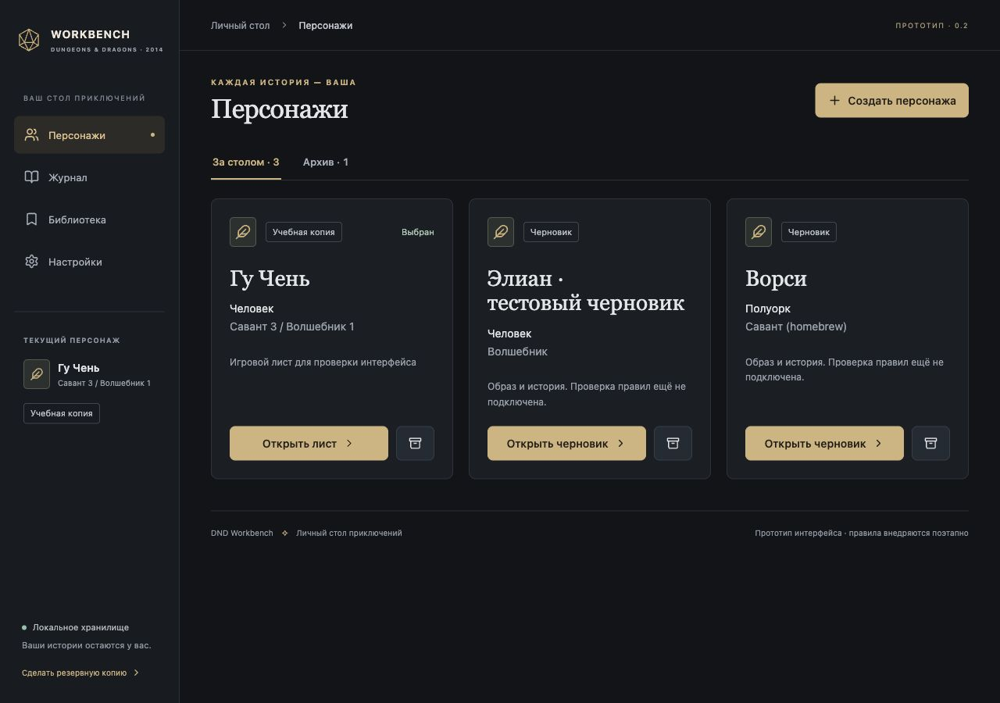

<div align="center">
  
  <h1>DND Workbench</h1>
  <p>Личный стол приключений: персонажи, игровые ресурсы и истории.</p>
  <p><strong>D&D 2014 · Русский интерфейс · Локальные данные · PWA</strong></p>
</div>

[](https://github.com/extrachicken/DND-Workbench/actions/workflows/ci.yml)

**Версия 0.2 — рабочий прототип.** Приложение развивается для личного
использования и игры с друзьями. Полная проверка создания, повышение уровня,
мультиклассы и каталог правил пока не реализованы.



## Что уже можно делать

| Возможность | Состояние |
|---|---|
| Персонажи | Список, выбор, создание и редактирование черновиков |
| Архив | Обратимое архивирование и восстановление |
| Учебный лист Гу Ченя | Хиты, временные хиты, остаток ячеек, кубики |
| История и снаряжение | История черновиков; портрет и простой инвентарь учебного листа |
| Журнал | Записи с группировкой по названию кампании или ваншота |
| Резервные копии | Экспорт v2, импорт v1/v2, копия перед заменой данных |
| Офлайн | Кеш production-сборки и локальная IndexedDB |
| Полные правила и каталог | Следующие этапы; охват описан в инженерном плане |

Черновик сохраняет имя, происхождение, класс и историю. Он не получает
характеристики учебного персонажа и не выдаётся за проверенный игровой лист.
У Гу Ченя часть показателей пока фиксирована; снаряжение их не пересчитывает.
Остаток ячеек может быть неизвестен или равен нулю — загрузка его не сбрасывает.

## Быстрый запуск

Нужен **Node.js 24** и npm.

```sh
git clone https://github.com/extrachicken/DND-Workbench.git
cd DND-Workbench
npm ci
npm run dev
```

Для клонирования приватного репозитория нужен доступ к нему. Адрес локального
приложения напечатает Vite.

Для проверки офлайна:

```sh
npm run build
npm run preview -- --port 4173
```

Откройте [локальный предпросмотр](http://127.0.0.1:4173/) на компьютере.
Первый запуск загружает файлы приложения. Офлайн-кеш включён в production,
а обновление применяется кнопкой в настройках.

На телефоне `127.0.0.1` указывает на сам телефон. Для установки на Android
понадобится отдельное HTTPS-размещение. Сайт пока не опубликован.

## Данные и восстановление

Данные хранятся в браузере на конкретном устройстве и адресе, включая порт.
Очистка данных сайта удаляет и рабочее пространство, и внутренние снимки.
Регулярно скачивайте внешнюю резервную копию в **Настройках**.

При переходе с 0.1 приложение переносит лист, заметки, настройки и черновики
в схему v2. Исходные данные сохраняются в точке восстановления. Импорт тоже
атомарно сохраняет предыдущее состояние: если запись снимка или новых данных
не удалась, замена отменяется.

Формат JSON: до 50 МБ, до 101 персонажа вместе с архивом. Синхронизации между
устройствами пока нет. Удаление персонажа заменено обратимым архивом.

## Проверки

```sh
npm run check       # форматирование, тесты, TypeScript и production-сборка
npm run format      # форматирование исходников
npm audit --omit=dev
```

GitHub Actions повторяет проверки на Node.js 24. Тесты покрывают ресурсы,
независимость персонажей, архив, реальные миграции IndexedDB, ошибочный импорт
и откат транзакций. Браузерные проверки и ограничения указаны в
[состоянии разработки](docs/progress.md).

## Устройство проекта

```text
src/
  components/Characters.tsx  список персонажей и редактор черновиков
  hooks/usePage.ts           навигация с защитой несохранённого текста
  main.tsx                  оболочка и экраны исходного прототипа
  model.ts                  схема v1 и базовые операции ресурсов
  workspace.ts              схема v2, миграция и операции персонажей
  db.ts                     IndexedDB и точки восстановления
  *.test.ts                 проверки модели и хранилища
  styles.css                адаптивный интерфейс
```

React · TypeScript · Vite · Dexie · Zod · Vitest · Vite PWA.

## План и документация

- [Инженерный план](docs/engineering-plan.md)
- [Дизайн-система](docs/design.md)
- [Прогресс и следующие задачи](docs/progress.md)
- [Проверочный кейс Гу Ченя](docs/gu-chen-validation-case.md)
- [История изменений](CHANGELOG.md)
- [Как работать над проектом](CONTRIBUTING.md)
- [Содержимое и источники](docs/content-policy.md)

Цель: официальные материалы редакции 2014 и весь homebrew dnd.su с учётом
источников, версий и доступности. Наличие записи в библиотеке и автоматизация
её механик будут отмечаться отдельно.
