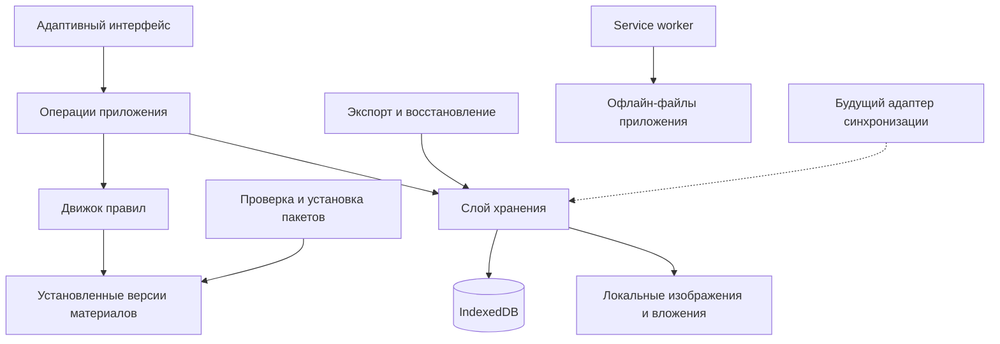

# DND Workbench: инженерный план

Дата: 14 ноября 2026 года. Статус: проектное предложение после уточнения
требований. Актуальное состояние приложения — в [журнале разработки](progress.md). Численные оценки ниже — ориентиры
для планирования, а не результаты измерений или обещанные сроки.

## 1. Зафиксированные требования

| Вопрос | Решение пользователя |
| --- | --- |
| Назначение | Личное использование; возможно, использование друзьями. |
| Правила | D&D 5e на основе редакции 2014 года, официальные дополнения и весь homebrew-раздел dnd.su. |
| Создание | Пользователь выбирает сам; приложение объясняет варианты, проверяет ограничения и считает характеристики. |
| Развитие | Повышение уровня, мультиклассы и черты нужны уже в первой версии для реальных игр. |
| Варианты правил | Включаются в настройках кампании. |
| Устройства | Android и браузер на компьютере. |
| Основной телефон | Honor X8b, Google Chrome; версии Android и Chrome зафиксировать при испытаниях. |
| Данные | Локально, с экспортом резервной копии. Синхронизация возможна позднее. |
| Язык | Русский интерфейс; поиск также по английским названиям. |
| Оформление | Спокойный тёмный интерфейс. |
| Кубики | Виртуальные броски и ручной ввод результатов настоящих кубиков. |
| Единицы | Переключение исходных единиц и метрических значений. |
| Правило текущей кампании | Мастер разрешил дополнительную черту; иных домашних изменений пользователь пока не назвал. |
| Первый контрольный персонаж | Гу Чень: Савант 3 (Следователь) / Волшебник 1. |
| Персонаж | ЛОР, портрет, здоровье, заклинания, способности, экипировка, инвентарь. |
| Заметки | Отдельно по сессиям, с группировкой в кампании и ваншоты. |
| Разработка | Один разработчик с Codex; фиксированного срока нет. |

## 2. Рекомендуемое решение

Начать с устанавливаемого **PWA**: адаптивного веб-приложения, которое хранит
данные на устройстве и выполняет создание персонажа, расчёты и игровые действия
без сервера. На Android оно открывается с домашнего экрана, на компьютере — в
браузере. Первоначальная загрузка приложения и выбранных каталогов требует
соединения. После явного завершения подготовки к офлайн-работе оно не требуется.
Возможность обслуживать приложение из локального кэша обеспечивают service
workers; для обычного размещения нужен HTTPS.
[Документация MDN](https://developer.mozilla.org/en-US/docs/Web/API/Service_Worker_API/Using_Service_Workers).

Предлагаемый стек: **TypeScript + React + Vite; IndexedDB через Dexie; service
worker для приложения; версионируемые пакеты данных для правил**. Движок правил
работает отдельно от интерфейса и базы. Dexie используется как локальная
библиотека; подключать Dexie Cloud для этого решения не требуется.
[Документация Dexie](https://dexie.org/docs/).

Если после испытаний понадобится именно APK, использовать тот же интерфейс и
движок в Capacitor. Для Android тогда потребуется отдельная реализация хранения
на SQLite и работы с файлами. Это дополнительный этап с собственными проверками.
SQLite-плагин выбирается после проверки поддержки, лицензии и совместимости;
официальное руководство Capacitor указывает в том числе на community-плагины.
[Capacitor](https://capacitorjs.com/docs),
[рекомендации по хранению](https://capacitorjs.com/docs/guides/storage).

В первой версии не нужен сервер с аккаунтами. Друзья могут установить приложение
и вести собственные локальные данные. Перенос между телефоном и компьютером
производится экспортом и импортом. Открытие одного адреса на двух устройствах
**не переносит персонажей автоматически**.

### Сравнение платформ

| Вариант | Android и компьютер | Офлайн | Хранение и резервные копии | Стоимость сопровождения для одного разработчика |
| --- | --- | --- | --- | --- |
| PWA | Один адаптивный интерфейс. | После первоначальной загрузки приложения и каталогов. | IndexedDB; внешний экспорт обязателен. | Наиболее простой старт при этих требованиях. |
| PWA + Capacitor для Android | Общий движок и значительная часть UI; две сборки. | APK может содержать приложение и базовый каталог с установки. | SQLite в Android, IndexedDB в браузере; общий формат обмена. | Добавляются Android-сборки, адаптеры и проверка плагинов. |
| Kotlin + Jetpack Compose | Удобен для Android; браузерный интерфейс потребует дополнительного решения. | Приложение и данные можно включить в установочный пакет. | Room/SQLite, нативная работа с файлами. | Не лучший старт при обязательном браузере и отсутствии требований к оборудованию телефона. |
| Flutter для Android и web | Может дать обе платформы из одного проекта. | Требует отдельного проектирования веб-кэша и хранилищ. | Нативное и браузерное хранение различаются. | Рабочая альтернатива, особенно при опыте Dart; для этого проекта преимуществ, перевешивающих обычный web, пока не выявлено. |

Последний столбец — инженерная оценка для данного проекта. Flutter официально
поддерживает веб-приложения, включая PWA; отвергать его из-за наличия браузерной
версии было бы неверно.
[Flutter web FAQ](https://docs.flutter.dev/platform-integration/web/faq).

Условие пересмотра решения: испытание на целевом Android показывает неудобный
экспорт, неприемлемое время запуска или требования к хранению, которые PWA
практически не обеспечивает. Тогда добавляется Capacitor, а не переписывается
движок правил. Локальный источник данных остаётся основой работы в обеих
платформах.
[Архитектура offline-first в Android](https://developer.android.com/topic/architecture/data-layer/offline-first).

## 3. Что означает «все материалы»

Полноту необходимо определить через фиксированный реестр источников, иначе
проект будет бесконечно догонять изменения сайта.

1. **Официальный каталог:** правила 2014 и совместимые с ними официальные
   дополнения. Базовая опись начинается с PHB, DMG, MM и дополнений, например
   Xanathar’s Guide, Tasha’s Cauldron, Volo’s Guide, Mordenkainen’s Tome,
   Monsters of the Multiverse, Eberron, Sword Coast, Fizban’s, книг сеттингов и
   приключений с игровыми опциями. Это примеры, а не законченный реестр.
2. **Homebrew:** весь игровой раздел dnd.su на дату фиксации каталога, включая
   классы, подклассы, расы, происхождения, черты, заклинания, предметы, существ
   и дополнительные механики. Нужны также авторские разделы внутри обычных
   страниц. Комментарии, новости и рекламные блоки в игровой каталог не входят.
3. **Будущие добавления:** отдельные обновления каталога с отчётом об изменениях.
   Первая дата фиксации будет выбрана при инвентаризации, до реализации импорта.
4. **Издание и источник:** материал относится к правилам 2014 по содержанию и
   источнику, а не только по году публикации или имени домена.
5. **Конфликтующие варианты:** сохраняются отдельными записями. Кампания выбирает,
   например, конкретную версию расы или класса; их свойства не складываются.

На проверенной странице классов dnd.su представлены 12 классов PHB,
изобретатель, напарники и отдельные авторские классы.
[Каталог классов](https://dnd.su/class/).
Официальные и авторские подразделы могут находиться на одной странице: такой
случай есть у изобретателя. Поэтому классификация только по наличию
`/homebrew/` в URL будет ошибочной.
[Страница изобретателя](https://dnd.su/class/137-artificer/).

Unearthed Arcana хранить с собственной меткой `playtest`, даже когда сайт
помещает её в homebrew. Например, так опубликован Мистик. Весь такой раздел
входит в согласованный охват, но не становится от этого официальным завершённым
правилом.
[Мистик на dnd.su](https://dnd.su/homebrew/class/208-mystic/).

### Две независимые меры готовности

| Мера | Что считается завершением |
| --- | --- |
| Полнота каталога | Каждая запись и вложенная игровая опция из зафиксированной описи учтены; нет необъяснённых пропусков, дублей и потерянных зависимостей. |
| Полнота автоматизации | Для каждой опции определены выборы, вычисляемые эффекты, расходы ресурсов и ограничения; применимые расчёты реализованы и проверены. |

У каждой способности хранить список поддержанных и неподдержанных эффектов.
Пользователь видит понятные статусы: «рассчитывается», «часть эффектов требует
ручного учёта», «только описание». Эти статусы нужны для честной работы
промежуточных сборок, а не для признания полной задачи выполненной.

Если не реализовано обязательное правило построения персонажа, нельзя выдавать
результат как полностью проверенный. Разрешаются черновик и явная ручная
коррекция с пояснением. Финальная цель — автоматизировать все формализуемые
операции выбранного каталога; решения мастера о сюжете, целях и допустимости
ситуации остаются вводом пользователя.

Для текущей кампании отдельно включается одна дополнительная черта от мастера.
Происхождение каждой черты сохраняется: раса, уровень класса, кампания или
индивидуальная награда. Бонус кампании не выдаётся автоматически всем новым
персонажам в других кампаниях.

Вся библиотека доступна для просмотра. В профиле кампании выбираются разрешённые
источники, варианты и homebrew-наборы. Наличие двух альтернативных классов в
каталоге не означает их одновременное применение к одному персонажу.

### Материалы и возможность распространения

SRD 5.1 — открытая основа правил 2014 по CC BY 4.0, но не полный набор книг,
подклассов, черт и заклинаний. SRD 5.2 относится к обновлённым правилам и не
подменяет требуемую редакцию.
[Официальная страница SRD](https://www.dndbeyond.com/srd).

Для каждого пакета отдельно записываются источник, автор, переводчик, лицензия
или другое основание использования и условия включения в сборку. Некоммерческое
назначение само по себе не является разрешением на раздачу всех текстов;
Fan Content Policy отдельно исключает простое переиздание правил и книг.
[Политика Wizards](https://company.wizards.com/en/legal/fancontentpolicy).

Архитектура поддерживает открыто распространяемую базу и подключаемые пакеты,
включая локальные пользовательские материалы. Сам механизм локального импорта
не создаёт права на содержимое. Для текстов и переводов вне открытых лицензий
основание использования остаётся отдельным пунктом подготовки каталога.
Подтверждённый публичный API, полный экспорт и разрешение на массовое
переиспользование dnd.su в этой проверке не установлены. Контакт для технического
согласования опубликован на сайте; сообщений никому не отправлялось.
[Контакты dnd.su](https://dnd.su/contacts/).

Это влияет на способ наполнения и передачи приложения друзьям, но не требует
сокращать архитектуру до одного SRD или прекращать разработку движка.

## 4. Пользовательские сценарии

### Создание без внешних гайдов

Мастер создания должен объяснять, что именно выбирается, зачем это нужно,
сколько вариантов можно взять и как изменится персонаж. Описание правила,
ограничения и сравнение вариантов доступны внутри приложения офлайн.

Предлагаемый маршрут:

1. Выбрать кампанию либо самостоятельного персонажа, профиль правил и стартовый
   уровень. Для высокого уровня выполнить ту же цепочку развития внутри мастера.
2. Указать концепцию, имя и необязательный портрет. ЛОР можно заполнить позже.
3. Выбрать класс первого уровня, расу и её вариант, предысторию. Позволить
   возвращаться между шагами без потери незатронутых решений.
4. Назначить характеристики: стандартный набор, покупка очков, броски или ручной
   ввод по разрешению мастера. Сохранить исходные числа и способ получения.
5. Сделать выборы навыков, инструментов, языков, умений и прочих владений.
6. Выбрать подкласс на положенном уровне, черты, боевой стиль и классовые опции.
7. Выбрать заклинания согласно конкретному источнику магии и особенностям класса.
8. Получить стартовое снаряжение или деньги по выбранному способу. Учесть
   снаряжение предыстории и вложенные варианты комплектов.
9. Проверить итог: обязательные незавершённые выборы, конфликтующие варианты,
   ограничения источников, объяснение всех вычисленных показателей.
10. Сохранить персонажа и открыть игровой экран.

Порядок экранов не должен становиться порядком вычислений. Например, изменение
расы может изменить доступность черты, а замена характеристики — доступность
мультикласса. Движок пересчитывает зависимости и показывает конкретные решения,
которые нужно повторить. Валидные выборы сохраняются.

Для новичка: короткое объяснение и пример. Для опытного игрока: компактный режим
и фильтры. Рекомендации по роли персонажа допустимы как подготовленные подсказки,
но не как скрытая оптимизация сборки. Работа не зависит от LLM, внешнего API
или доступа к интернету.

### Развитие и исправление персонажа

Повышение уровня оформляется как отдельный черновик изменений:

- Выбор следующего класса с проверкой условий мультиклассирования.
- Показ общего уровня и уровня каждого класса отдельно.
- Получение хитов и кости хитов нужного типа; фиксация броска или фиксированного
  значения. Изменение Телосложения корректно влияет на максимум хитов.
- Получение умений, подкласса, увеличения характеристик или черты на нужном
  уровне конкретного класса.
- Изменение числа заклинаний, ячеек и ресурсов; разрешённые замены известных
  заклинаний и классовых выборов.
- Предварительный просмотр разницы и атомарное подтверждение всего повышения.

Поддержать опыт, повышение по сюжетным вехам и ручное назначение уровня мастером.
Достижение порога опыта предлагает повышение, но не завершает обязательные
выборы за игрока. Обычный предел — 20 общих уровней персонажа; расширяющий его
homebrew должен задавать собственные правила, а не случайно обходить проверку.

Откат последнего повышения восстанавливает прежнее состояние. Изменение старого
уровня запускает перепроверку последующих решений. «Исправить ошибку в листе» и
«пересобрать по разрешению мастера» имеют явную причину и историю; приложение
не выдаёт произвольный пересбор как обычное правило повышения.

### Игра на сессии

Игровой экран открывается сразу на текущем персонаже. Основные действия:
получить урон, вылечиться, использовать способность, сотворить заклинание,
израсходовать предмет, сделать бросок, добавить заметку, завершить отдых.
Для случайного нажатия доступна отмена с восстановлением связанных ресурсов.

Лист содержит шесть характеристик и их модификаторы, бонус мастерства,
навыки и компетентность, спасброски, пассивные проверки, инициативу, КД,
скорости перемещения, размер, чувства, языки и владения. Отдельно показываются
вдохновение, защиты и иммунитеты, доступные атаки, сложности спасбросков,
действия, бонусные действия и реакции. Долговременные особенности не теряются
среди временных эффектов. Для отслеживания собственного хода можно дать
ручные отметки действий; управление инициативой всей группы и картой боя
не требуется для работы личного листа.

### Подготовка и записи

Пользователь может вести кампании, ваншоты, сессии, персонажей, записи о NPC,
местах, заданиях и добыче. Все эти функции работают без входа в аккаунт.
Одна сессия может ссылаться на несколько своих персонажей. Использование одного
персонажа в разных кампаниях требует явного решения: общая непрерывная история
либо отдельная копия, чтобы здоровье и инвентарь не смешивались неожиданно.

## 5. Движок правил

Главный технический компонент — библиотека детерминированных расчётов без React,
браузерных API, сетевых запросов и прямой записи в базу.

Её входы: исходные характеристики, последовательность уровней, сделанные выборы,
зафиксированные версии материалов, профиль кампании, экипировка и текущие
эффекты. Выходы: итоговый лист, доступные действия, незавершённые выборы,
ошибки и объяснение происхождения каждого значения.

### Модель вычислений

Разделить данные на четыре группы:

| Группа | Примеры | Принцип |
| --- | --- | --- |
| Исходные решения | Характеристики до бонусов, класс каждого уровня, выбранные навыки. | Хранятся как решения пользователя. |
| Определения правил | Черта, таблица класса, описание предмета, заклинание. | Неизменяемые версии из каталога. |
| Вычисленные значения | Бонус атаки, КД, максимум ресурса, доступные ячейки. | Пересчитываются; сохранённая копия служит кэшем и аварийным просмотром. |
| Текущее состояние | Потраченные ячейки, текущие хиты, заряды предмета, концентрация. | Меняется игровыми командами в транзакции. |

Числовой модификатор хранить вместе с происхождением, условием применения,
операцией и правилом совместимости. Поддержать как минимум прибавление,
установление значения, минимальный порог, ограничение сверху, альтернативную
формулу и исключение. Формулы КД нельзя складывать как обычные бонусы.

Для эффектов нужна явная область: персонаж, навык, конкретное оружие, отдельное
заклинание, выбранный ресурс или временная форма. Учитывать порядок применения
и округления, а также идентичность эффектов, которые не суммируются.

Выборы представлять отдельными сущностями: «выбрать N из набора с условиями»,
с возможностью вложенных альтернатив. Валидация проверяет дубликаты, требования,
связанные замены, ограничения уровня и циклические зависимости.

Правила бывают трёх видов:

1. Универсальные декларативные эффекты и условия.
2. Специализированные обработчики сложных механик в проверенном коде проекта.
3. Решения, требующие контекста игрока или мастера; приложение запрашивает этот
   контекст либо показывает пояснение.

Не создавать собственный универсальный язык программирования для всей D&D.
Начать с небольшого набора типизированных операций и расширять его по реальным
пакетам. Импортируемый homebrew не содержит исполняемый JavaScript: формулы
проходят ограниченный парсер, без `eval` и доступа к файлам или сети.

### Уровни и мультиклассы

Общий уровень, уровень класса и уровень для таблицы ячеек — разные величины.
Порядок взятия уровней сохраняется: первый класс влияет на начальные владения,
а последующие классы не повторяют весь стартовый набор. Повторяющиеся классовые
возможности требуют отдельных правил объединения.
Известные и подготовленные заклинания определяются по каждому классу, а общий
пул ячеек рассчитывается отдельно. Pact Magic хранится отдельным пулом.
[Официальные правила мультиклассирования 2014](https://www.dndbeyond.com/sources/dnd/basic-rules-2014/customization-options).

Таблицы и правила округления должны быть частью конкретного источника. Нельзя
распространять одну формулу половины уровня на все классы и homebrew. Например,
у изобретателя есть собственное правило вклада в мультиклассовые ячейки.
[Изобретатель](https://dnd.su/class/137-artificer/).

### Контекст и ручные поправки

Режим игры знает состояние своего персонажа, но не знает автоматически видимость,
дистанцию до цели, иммунитет противника и решение мастера. Поэтому ситуативные
эффекты требуют переключателя или вопроса в момент действия. Не запрещать
заклинание только потому, что приложение не моделирует всю сцену.

Ручная поправка — отдельная запись: что изменено, на сколько, почему и до какого
события действует. Она не заменяет исходное правило и может быть отключена.
Конфликт с правилами показывается рядом с изменённым значением.

Гу Чень задаёт ранние требования к движку: замена характеристики в конкретной
формуле, временно полученное владение, бонус только к пассивным проверкам,
атака по выбранной Метке и концентрация на способности, которая не является
заклинанием. Концентрация поэтому связывается с активным эффектом любого типа.
Лимиты реакций и их восстановление также задаются правилами: homebrew может
изменять обычное количество реакций на более высоких уровнях.

## 6. Магия и способности

Каждый источник магии хранится отдельно: класс, раса, черта, предмет или особое
умение. Одно заклинание может быть получено несколькими путями с разными
характеристиками, ограничениями и ресурсами.

Необходимы:

- Заговоры, известные, подготовленные, всегда подготовленные заклинания и книга
  заклинаний как разные наборы.
- Пулы обычных ячеек, Pact Magic, отдельные использования без ячеек и заряды
  предметов; Mystic Arcanum и аналогичные возможности как самостоятельные ресурсы.
- Выбор источника и уровня применения; масштабирование эффекта по ячейке,
  общему уровню или уровню класса согласно конкретному правилу.
- Ритуалы с проверкой доступа именно к ритуальному применению.
- Компоненты, стоимость, расходуемость и связь с инвентарём.
- Концентрация, длительность, активные эффекты и запрос проверки после урона.
- Подготовка и разрешённая замена заклинаний в подходящий момент.
- Короткие описания действий и полное локальное описание правила.

Карточка применения сначала показывает расход, затем одной командой сохраняет
расход ресурса и изменения состояния. Повторная доставка команды не должна
повторно списать ячейку или предмет. Отмена восстанавливает всю операцию.

Если последующие действия зависят от отменяемого, сначала проверяется цепочка
зависимостей. Нельзя подменять отмену одного расхода восстановлением всего
старого листа и тем самым стирать более позднюю заметку или получение предмета.

Ограничения заклинаний проверяются по правилам 2014. Нельзя подменять их правилом
из редакции 2024 или общим запретом «только одно уровневое заклинание за ход».
Для компонентов важно отличать их стоимость и расходуемость; фокусировка не
является универсальной заменой любого компонента.
[Spellcasting, Basic Rules 2014](https://www.dndbeyond.com/sources/dnd/basic-rules-2014/spellcasting).

Для homebrew предусмотреть типы ресурсов кроме ячеек: очки, кости, заряды,
напряжение, лимиты на действие и собственные события восстановления. Подкласс
может добавлять или заменять правило базового класса, а не только давать бонус.

## 7. Здоровье, состояния и отдых

Отдельно хранить текущие, максимальные и временные хиты, временное изменение
максимума, состояние при нуле хитов и результаты спасбросков от смерти.
Урон разбивается на компоненты с типом и контекстом; сопротивления, иммунитеты
и уязвимости применяются к соответствующим компонентам с объяснением расчёта.

Временные хиты не складывать автоматически и не смешивать с обычным лечением.
Потерю сознания, стабилизацию, смерть и возвращение хитов обрабатывать как
различимые состояния. Сложное исключение способности имеет приоритет только
там, где это предусмотрено её правилом.
[Combat, Basic Rules 2014](https://www.dndbeyond.com/sources/dnd/basic-rules-2014/combat).

Состояния и уровни истощения показываются явно; применимые штрафы входят в
объяснение показателей. Преимущество и помеха хранят причины, чтобы их можно
было проверить. Правила истощения 2014 и альтернативы не смешиваются.

Отдых — операция с предварительным просмотром. Различать восстановление после
короткого отдыха, длительного отдыха, на рассвете и по индивидуальному условию.
Кости хитов хранить по типам. Длительный отдых 2014 не означает восстановление
всех потраченных костей хитов. Время учитывать как игровое: перевод телефона
на следующий день не должен восстанавливать ресурсы персонажа.
[Отдых в Basic Rules 2014](https://www.dndbeyond.com/sources/dnd/basic-rules-2014/adventuring).

Для превращений и существ-спутников нужны дополнительные листы: форма,
отдельное здоровье, замена определённых характеристик, сохранённые особенности
и правила возвращения. Дикий облик, фамильяр, призванное существо и постоянный
спутник имеют различные механики. Эти сценарии входят в целевую поддержку
соответствующих классов, а не сводятся к текстовой заметке.

## 8. Предметы и экономика

Разделить шаблон предмета из каталога и конкретный экземпляр у персонажа.
Два одинаковых магических предмета могут иметь разные заряды, имена и историю.

У экземпляра сохраняются количество, местоположение, контейнер, владелец,
экипировка, настройка, заряды, идентификация и пользовательские особенности.
Вместимость контейнера и переносимый вес — связанные, но разные проверки.
Не допускать циклического помещения контейнеров друг в друга.

Операции: получить, купить, продать, передать, разделить стопку, переместить,
экипировать, настроиться, использовать и удалить. Покупка и расход денег
сохраняются одной транзакцией. Стоимость не всегда задана правилами точно;
для таких вещей используется согласованная с мастером цена.

Нужны проверки владения бронёй и оружием, занятости рук, ограничений настройки,
боеприпасов, требований предметов, специальных вместилищ и вариантов нагрузки.
Хранить деньги точными целыми значениями в минимальной единице; при необходимости
сохранять также состав кошелька по монетам. Вес и дистанции хранить в единой
канонической системе с отдельным отображением единиц.

Оружие строит доступные атаки из свойств экземпляра, владения, характеристики
и эффектов. Не считать, что атака всегда использует Силу или что для всего
инвентаря действует единый бонус. Магический предмет начинает влиять на лист
только при выполнении своих условий использования.

## 9. ЛОР, портреты и заметки

ЛОР содержит свободный текст и необязательные поля: внешность, происхождение,
цели, привязанности, идеалы, слабости, союзники и важные события. Портрет хранится
локальным файлом, а не ссылкой на чужой сервер. Импорт изображения предлагает
обрезку; создаются миниатюра и оптимизированная копия. Исходник можно включать
в резервную копию отдельной настройкой.

Структура записей:

**Кампания или ваншот → сессии → заметки**, дополнительно отдельные справочные
записи о местах, NPC и заданиях. У сессии есть дата игры, название, номер,
персонажи, краткое резюме, события, добыча и открытые вопросы.

Редактор: форматированный текст или Markdown с простыми кнопками, списки,
ссылки на персонажа и материалы, теги, закрепление, поиск, автосохранение,
история версий и корзина. Ссылка на правило открывает установленную локальную
карточку. Вставленное внешнее изображение не считается доступным офлайн, пока
его разрешённая копия не сохранена на устройстве.

Заметки сессии и боевой журнал различаются. Случайный расход ячейки можно
отменить; это не должно удалять написанный пользователем текст. Итог сессии
можно вручную дополнить фактами из журнала, без обязательной ИИ-генерации.

При передаче персонажа другому человеку отдельно выбирается, включать ли ЛОР,
портрет и заметки. Личные записи не добавляются в общий файл незаметно.

## 10. Интерфейс

Главная навигация: **Персонажи, Кампании, Справочник, Настройки**. Внутри
персонажа: **Игра, Способности, Заклинания, Инвентарь, История и ЛОР**.
Заметка текущей сессии доступна быстрым действием с игрового экрана.

На телефоне основные кнопки находятся в нижней части экрана; на компьютере
появляется боковая навигация и панель подробностей. Боевой экран не заставляет
прокручивать длинный справочник ради изменения здоровья.

Визуальные принципы:

- Спокойная тёмная палитра, достаточный контраст и один основной акцент.
- Хорошо различимые текущие значения и максимумы ресурсов.
- Статусы передаются текстом и значком, а не только цветом.
- Комфортные области нажатия порядка 44–48 CSS px, масштабирование текста,
  работа клавиатурой и понятные подписи для экранного чтения.
- Частые действия занимают один-два шага; подтверждение нужно для потери данных,
  пересборки и значимых расходов, а не для каждого нажатия.
- Объяснение расчёта открывается по самому показателю: «из чего получилось».

Поиск учитывает русское и английское названия, распространённые альтернативные
переводы, `е/ё`, регистр и опечатки. Результаты группируются по типам и источникам.
Фильтр разрешённых кампанией материалов не скрывает существование других
материалов в общем справочнике.

Виртуальные броски показывают исходные кубики, модификаторы, преимущество/помеху
и итог. Генератор случайных чисел отделён от правил; для воспроизводимых тестов
его можно подменить. Результат физического броска обозначается как введённый
вручную. Анимация необязательна и отключается.

В прошлой работе над Гу Ченем пользователь отдельно требовал сохранять полный
текст техник при печати. Поэтому в первую игровую версию рекомендуется включить
печатный лист и полное приложение со способностями, заклинаниями и выбранным
ЛОРом. Длинный текст переносится на дополнительные страницы. Это отдельная
печатная раскладка, а не снимок экрана с обрезанными полями.

## 11. Архитектура приложения



Один репозиторий, одна сборка web и несколько модулей с ясными границами.
Микросервисы и отдельный сервер правил не нужны.

Предлагаемая структура:

```text
apps/web/                  интерфейс и запуск PWA
packages/domain/           персонаж, кампании, игровые команды
packages/rules/            расчёты, проверки, объяснения
packages/content-schema/   схемы и проверка пакетов
packages/storage/          IndexedDB, транзакции, миграции, резервные копии
tools/content/             инвентаризация и подготовка каталогов
content/manifests/         реестры источников и версии пакетов
tests/fixtures/            проверенные персонажи и случаи правил
docs/                      решения, покрытие, инструкции
```

Пока это схема будущего репозитория, а не созданный каркас приложения.
Проверенные специальные обработчики homebrew располагаются в движке, а
пользовательские пакеты содержат данные. UI не вычисляет правила в обработчиках
кнопок и не хранит единственную копию персонажа в состоянии React.

### Сущности данных

| Сущность | Основные данные |
| --- | --- |
| Campaign | ID, тип «кампания/ваншот», название, описание, профиль правил. |
| RulesProfile | Редакция, разрешённые источники, версии вариантов, включённые опциональные правила. |
| Character | ID, имя, исходные характеристики, связи с кампанией, версии схемы/движка, закреплённые пакеты. |
| LevelEntry | Порядковый уровень персонажа, класс, уровень класса, хиты и выборы этого шага. |
| ChoiceSelection | ID предложения выбора, выбранные опции, источник, зависимые решения. |
| CharacterState | Хиты, концентрация, состояния, ресурсы, игровое время и текущая форма. |
| ResourcePool | Источник, тип, максимум, расход, правило восстановления. |
| SpellGrant | Заклинание, путь получения, характеристика, способ и ограничения применения. |
| ItemDefinition / ItemInstance | Шаблон из каталога / конкретный предмет в инвентаре. |
| EffectInstance | Источник, цели, параметры, начало, завершение, ручное подтверждение контекста. |
| Session / Note | Кампания, даты, связи, текст, версия, теги, архивирование. |
| Asset | ID, тип, размер, хеш, локальные данные, ссылки владельцев. |
| ContentPack / ContentEntry | Версия, зависимости, происхождение, редакция, содержимое и статус автоматизации. |
| ActionRecord | ID команды, причина, изменение, возможность отмены. |

У объектов с потенциальной синхронизацией заранее предусмотрены устойчивый ID,
номер ревизии и признак удаления. Реализовывать распределённую систему ради
этого сейчас не нужно. Для первоначальной версии достаточно снимков состояния,
транзакций и ограниченного журнала изменений; полное event sourcing избыточно.

## 12. Подготовка каталога

Сбор данных и игровое приложение — разные процессы. Телефон не парсит сайт
при открытии карточки и не зависит от его доступности или CORS.

Цепочка подготовки:

1. **Инвентаризация:** собрать категории, страницы, вложенные игровые разделы,
   источники, авторов, версии и варианты. Отдельно отметить недоступные записи.
2. **Происхождение и условия:** определить, что можно включить в распространяемую
   сборку, что требует другого основания и что остаётся пользовательским пакетом.
3. **Получение:** сначала проверить возможность согласованного экспорта/API.
   При допустимом HTML-импорте использовать ограниченную частоту, кэш,
   контроль изменений и обработку ошибок, без обхода ограничений доступа.
4. **Нормализация:** выделить сущности и вложенные опции; сохранить исходный
   адрес, раздел, дату, исходный идентификатор и хеш полученного материала.
5. **Разметка механик:** связать текст с условиями выбора, таблицами, ресурсами
   и эффектами. Предложенную Codex разметку проверять на примерах.
6. **Проверка:** схемы, ссылки, дубликаты, зависимости, таблицы уровней,
   совместимость редакций и сценарии персонажей.
7. **Сборка пакетов:** сформировать manifest, поисковый индекс, данные и отчёт
   о покрытии. Необработанные изменения не попадают в стабильный каталог.
8. **Обновление:** сравнить версии, предложить миграцию и сохранить возможность
   открыть персонажа с ранее закреплёнными материалами.

Не считать число URL числом игровых опций. У одной страницы могут быть десятки
подклассов, вложенных таблиц и дополнительных умений. Один материал также может
иметь несколько адресов или перепечаток. Проверка полноты должна работать по
сущностям и источникам, а не по факту завершения обхода сайта.

Пакет хранит `packId`, версию, редакцию, автора, язык, зависимости, совместимую
версию движка, хеш содержимого, сведения об использовании и список опций.
У записи есть устойчивый внутренний ID, русское и оригинальное название,
источник и версия. Обновление перевода и изменение механики различаются.

Проверять официальность и редакцию на уровне раздела и записи. Нельзя считать
каждую ссылку из страницы 2014 ссылкой на правило 2014: связанный сайт может
перенаправить её на актуальную редакцию.

### Особенности homebrew

Авторские материалы могут вводить новые типы прогрессии, альтернативные классы,
системы магии, безумия, изготовления предметов или изменения базовых действий.
Потребуются отдельные обработчики и тесты. Если текст не определяет сочетание
с другой системой, сохранить явную интерпретацию профиля кампании либо запросить
решение мастера; не придумывать незаметное универсальное правило.

Для создания собственного материала сначала достаточно редактора предмета,
ресурса и простой способности. Полноценный визуальный редактор произвольного
класса — отдельный этап. Он не является обязательным условием импорта всего
существующего каталога.

## 13. Офлайн, сохранение и восстановление

### Гарантия офлайн-готовности

Приложение показывает список установленных пакетов и результат подготовки:
приложение сохранено, каталог установлен, зависимости присутствуют, индекс
готов. Только после завершения этих проверок показывается «Готово без интернета».

Офлайн доступны создание и развитие персонажа, поиск, все установленные
описания, расчёты, игра, портреты, заметки, броски и экспорт. Шрифты, иконки и
необходимые скрипты поставляются вместе с приложением. Интернет нужен для
первой установки, новых пакетов, обновлений и будущей синхронизации.

Установка пакета выполняется в staging-области: загрузка, проверка целостности,
проверка зависимостей, затем переключение активной версии. Обрыв соединения
не оставляет половину каталога активной. Удаление пакета с зависимыми
персонажами требует сохранить нужную версию либо разрешить конфликт.

### Сохранность

Основные данные находятся в IndexedDB. Запись игрового действия, его ресурсов
и журнала выполняется транзакционно. Сообщение «сохранено» появляется после
успешной записи. Ошибка квоты или записи показывается пользователю, а текущий
черновик удерживается для экспорта.

Запрашивать persistent storage и проверять фактический результат. При этом
не обещать вечную сохранность: браузерное хранилище имеет политики очистки,
а пользователь может удалить данные сайта. Внешняя резервная копия необходима
даже при установленном PWA.
[Политики хранения MDN](https://developer.mozilla.org/en-US/docs/Web/API/Storage_API/Storage_quotas_and_eviction_criteria).

Автосохранение текста — с небольшим интервалом и периодическими контрольными
точками. Не полагаться только на событие закрытия страницы. Для нескольких
открытых вкладок использовать ревизии и межвкладочные уведомления; устаревшая
вкладка не должна перезаписывать свежий персонаж.

### Формат резервной копии

Один архив, например `.dndwb`, содержит manifest с версией формата, персонажей,
кампании, сессии, заметки, изображения, необходимые локальные определения
материалов и контрольные суммы. Полная личная резервная копия и файл «поделиться
персонажем» — разные операции с разным выбором вложений.

Восстановление должно проверяться на чистом профиле браузера без интернета.
Для самодостаточной копии нужны точные зависимости правил; одних URL недостаточно.
Если зависимый пакет не включён, архив обязан явно сообщать об этом до экспорта.
При отсутствующих правилах после импорта сохраняется читаемый снимок листа,
но редактирование с пересчётом не выдаётся за корректное до восстановления пакета.

Импорт сначала показывает состав, ошибки и совпадающие ID. Пользователь выбирает
создание копии или замену конкретной записи. Замена сохраняет предыдущую версию.
Перенос файла не является синхронизацией; две независимо изменённые копии
персонажа не объединяются автоматически.

Внутренние снимки помогают отменять изменения, но удаляются вместе с базой
браузера. Напоминание о внешнем экспорте показывается после сессии и перед
существенной миграцией. Не обещать автоматическую фоновую запись архива в папку:
доступ к файлам зависит от браузера и действий пользователя.

### Обновления

Версии схемы данных, каталога и движка различаются. Исправление правила может
изменить расчёты старого персонажа, поэтому перед применением показывается
разница и создаётся снимок. Пакеты закреплены за персонажем; миграция на новую
версию явно подтверждается.

Обновление приложения не перезапускает его посреди сессии. Миграции базы
проверяются на реальных архивных форматах; поддерживается восстановление из
экспорта. Откат приложения допустим только к версии, совместимой со схемой
данных. Бесконечная поддержка всех старых движков не предполагается: для старых
архивов нужен проверенный путь миграции или режим чтения сохранённого листа.

## 14. Безопасность и приватность

Локальный режим не отправляет портреты, ЛОР, заметки и игровые действия на
сервер. Хостинг получает обычные запросы за приложением и каталогами; это
отличается от синхронизации пользовательских данных. Внешняя аналитика и
отправка содержимого ошибок по умолчанию не нужны.

Импорт проверяет схему, размер, вложенность, типы изображений, зависимости,
архивные пути и итоговый объём распаковки. HTML из каталогов и заметок очищается;
скрипты, произвольные обработчики и исполняемые формулы не допускаются.
Изображения декодируются в безопасный поддерживаемый формат.

Контрольная сумма обнаруживает повреждение, но не доказывает автора пакета.
Для официального канала обновления использовать HTTPS, а при необходимости
подписанный manifest. Ключи сервисов в клиентское приложение не включаются.

Видимый пользователю результат импорта — список материалов и изменений.
Технические сведения о схеме и хешах остаются в диагностике, а не в мастере
создания персонажа.

## 15. Будущая синхронизация

Сейчас достаточно интерфейса хранилища, устойчивых ID и ревизий. Сервер,
аккаунты и платный сервис не являются зависимостью первой версии.

Если синхронизация появится, локальная база остаётся рабочей при отсутствии
сети. Добавляются очередь исходящих операций, идентификаторы для защиты от
повторного применения, ревизии сервера и обработка удалений.

Не использовать безусловное правило «последняя запись побеждает» для всего
персонажа: так можно потерять расход ячеек, повышение уровня или содержимое
инвентаря. Независимые заметки можно объединять, конфликтующие правки одной
заметки сохранять обеими версиями. Для игрового состояния в первом варианте
синхронизации проще выбрать одно активное устройство и разрешать конфликты
явно, чем строить распределённый боевой журнал.

Общий доступ мастера и совместные кампании — следующий продуктовый этап:
потребуются права на отдельные записи, разделение личных и общих заметок,
приглашения и собственная модель конфликтов. Это не включается скрыто в
«синхронизацию между моими устройствами».

## 16. Проверки и критерии качества

Правильность правил нельзя установить только тем, что приложение собирается.
Нужны независимые примеры с ожидаемым результатом, ссылкой на конкретное
правило и выбранной интерпретацией. Ожидания проверяет человек; генерация
реализации и ожидаемых чисел одним и тем же промптом не даёт независимой проверки.

### Уровни проверки

| Уровень | Проверка |
| --- | --- |
| Схемы | Все записи пакета валидны, ссылки и зависимости разрешаются. |
| Формулы | Граничные значения, округление, совместимость эффектов, альтернативные формулы. |
| Сценарии | Создание, повышение, замена выбора, расход, отдых, экипировка, откат. |
| Свойства | Пересчёт не меняет исходные решения; экспорт и импорт сохраняют смысл; отмена возвращает затронутое состояние. |
| Хранилище | Транзакции, миграции, заполненный диск, повтор команды, конфликт вкладок. |
| Интерфейс | Полный путь пользователя на телефоне и компьютере, клавиатура, масштабирование. |
| Офлайн | Запуск после закрытия браузера, новые персонажи и поиск в авиарежиме. |
| Практика | Полная пробная сессия с реальным Android и замечаниями пользователя. |

### Обязательные контрольные случаи

1. Все официальные классы из описи проходят развитие до 20-го общего уровня;
   каждый подкласс проверяется на уровнях появления и изменения своих умений.
2. Разные способы получения характеристик сохраняют исходные числа и бонусы
   раздельно; повторный пересчёт не добавляет бонус второй раз.
3. Замена расы, предыстории или раннего класса помечает затронутые выборы и
   сохраняет независимые.
4. Мультикласс соблюдает требования; порядок первого и второго классов влияет
   на стартовые владения ожидаемым образом.
5. Ячейка более высокого уровня не открывает автоматически заклинания такого
   уровня для каждого класса; Pact Magic не теряется в общем пуле.
6. Изобретатель и специальные классы проходят собственные правила округления.
7. Повтор Extra Attack и альтернативные формулы защиты не складываются без
   соответствующего специального правила.
8. Изменение Телосложения корректно меняет максимум хитов; текущие хиты
   обрабатываются по явной политике изменения состояния.
9. Одинаковое заклинание от двух источников сохраняет разные способы применения.
10. Ритуальное применение не тратит обычную ячейку, если выполнены его условия;
    использование предмета расходует соответствующий ресурс.
11. Новая концентрация завершает предыдущую; отмена восстанавливает согласованное
    состояние и расход.
12. Временные хиты, лечение, ноль хитов, стабилизация и спасброски от смерти
    проверяются раздельно, включая исключения способностей.
13. Два источника одинакового сопротивления не уменьшают урон повторно.
14. Короткий, длительный отдых и рассвет восстанавливают разные наборы ресурсов;
    смешанные типы костей хитов сохраняются.
15. Снятие или завершение настройки предмета убирает его эффекты; временный
    эффект не изменяет исходный шаблон предмета.
16. Расход последнего предмета, разделение стопки, покупка и продажа сохраняют
    целостность количества и денег, в том числе при отмене.
17. Дикий облик и возвращение проверяются на переносе состояния и хитов;
    характеристики спутника не подменяют характеристики владельца.
18. Представительные homebrew-наборы проверяют новую систему ресурсов,
    альтернативный класс и замену базовой механики.
19. Первая установка с прерыванием сети не помечается как готовая к офлайну.
20. Закрыть приложение, включить авиарежим, создать персонажа, повысить уровень,
    провести отдых, записать заметку и экспортировать результат.
21. Восстановить полный архив в чистом профиле без сети, включая портреты,
    заметки, зависимости и текущее состояние.
22. Повреждённый архив, неизвестная версия или отсутствующий пакет не уничтожают
    уже существующих персонажей.
23. Две вкладки и повторное нажатие не вызывают тихую перезапись или повторный
    расход одного действия.
24. Обновление каталога и миграция базы не применяются частично.

Набор не исчерпывает все сочетания D&D. Все пары классов проверяются на базовых
правилах объединения; более сложные сочетания покрываются по видам взаимодействий
и найденным дефектам. Для каждого импортируемого материала проверяется вся
структура, а для каждой новой механики добавляется самостоятельный сценарий.

Первый конкретный набор сценариев:
[Гу Чень — данные, расхождения и проверки](gu-chen-validation-case.md).
Он составлен по актуальному листу Aternia, локальным PDF и связанному чату.
Исходный лист и памятка не считаются автоматически правильными ожидаемыми
результатами: найденные расхождения разобраны отдельно.

Предлагаемые инструменты: Vitest для движка и данных, библиотека проверки
инвариантов по необходимости, Playwright для пользовательских сценариев.
Эмуляция мобильного браузера дополняется испытаниями на настоящем Android.

### Целевые показатели приложения

- Холодный офлайн-запуск до рабочего экрана: ориентир до 3 секунд на Honor X8b
  пользователя в Google Chrome; фактические версии ОС и браузера записываются.
- Локальный поиск: ориентир до 150 мс для 95% запросов на полной описи.
- Подтверждение обычного игрового действия и сохранение: ориентир до 200 мс.
- Ни одно завершённое сохранение не теряется при обычном закрытии и повторном
  запуске приложения.
- Длительный импорт имеет прогресс и возможность продолжить либо безопасно
  отменить; интерфейс не зависает на больших каталогах.

Это критерии будущих измерений. Размер базы, памяти и архива уточняется по
реальному каталогу; сейчас нет оснований обещать конкретные мегабайты.

## 17. Этапы разработки

Для каждого этапа заданы критерии приёмки. Полный игровой выпуск включает согласованный охват правил и материалов.

| Этап | Результат | Критерий завершения |
| --- | --- | --- |
| 0. Реестр и спецификация | Источники, варианты, опись homebrew, словарь терминов, контрольные персонажи, схема пакетов. | Известно, что означает полнота, какие данные доступны и какие механики потребуются. |
| 1. Офлайн-хранилище и восстановление | PWA, локальная база, экспорт/импорт, портрет, заметка, простая карточка персонажа. | Полный цикл создания данных и восстановления на Android и компьютере без сети. |
| 2. Проверка движка на сложных примерах | Мастер создания, развитие, эффекты, мультикласс и магия на небольшой тестовой выборке. | Проходят сценарии Гу Ченя, обычного бойца, подготовляющего заклинателя и колдуна. Homebrew Саванта проверяется уже здесь. |
| 3. Официальные правила | Полный официальный каталог по описи, классы, подклассы, черты, магия, предметы и соответствующие существа. | Отчёт о покрытии и сценарии подтверждают все заявленные автоматические расчёты. |
| 4. Homebrew | Полная опись сайта, пакеты авторов, специализированные механики и разрешение конфликтов. | Нет необъяснённых пропусков; формализуемые операции целевого каталога реализованы и проверены. Неподдержанная обязательная механика означает, что этап ещё не завершён. |
| 5. Готовность к сессиям | Боевой экран, весь инвентарь, отдых, формы, заметки, броски, удобство телефона, восстановление. | Проведена пробная сессия и восстановление полного архива; устранены блокирующие ошибки. |
| 6. Первая версия по всему запросу | Зафиксированный выпуск приложения и каталога, инструкция, резервные копии и проверки. | Мультиклассы и черты доступны; охват официальных и homebrew-материалов соответствует описи. |
| 7. Развитие | При необходимости APK, синхронизация, общий доступ, редактор сложного homebrew. | Отдельные критерии для каждой добавленной возможности. |

Часть этапов перекрывается: экран сессии и заметки можно развивать, пока
проверяется каталог. Зависимости при этом сохраняются: нельзя завершить
автоматизацию неизвестной механики до её разбора и определения ожидаемого
поведения.

Пользоваться промежуточной сборкой со своими проверенными персонажами можно
раньше этапа 6. Это полезная альфа с известными границами, а не объявление
всего homebrew поддержанным. Если понадобится ранний выпуск только для текущей
партии, его состав можно будет отдельно согласовать.

### Оценка трудоёмкости

Для одного разработчика с Codex предлагаются широкие ориентиры:

| Объём | Ориентир |
| --- | --- |
| Этапы 0–1: спецификация, проверка данных, PWA и надёжное хранение. | 50–110 часов. |
| Этап 2: движок и сквозные сложные примеры, включая мультикласс. | Ещё 100–220 часов. |
| Доведение основных игровых модулей, интерфейса и проверок до удобной альфы. | Ещё 120–260 часов. |
| Полный официальный каталог, все homebrew-механики, проверка полноты и сочетаний. | До инвентаризации достоверная оценка отсутствует; вероятно, это крупнейшая часть проекта. |

Первые три строки дают примерно 270–590 часов на инженерную основу и удобную
альфу ограниченного охвата. При условных 10 часах в неделю это 27–59 недель,
при 20 часах — примерно 14–30 недель. Полный запрос с автоматизацией всего
homebrew может существенно превысить этот объём. Эти оценки особенно зависят
от опыта разработчика и объёма ручной проверки материалов.

После обработки первых представительных пакетов оценивать остаток как сумму
неразобранных типов страниц, новых механик, проверок и исключений. Не оценивать
тысячу однотипных предметов так же, как тысячу уникальных классовых возможностей.

На первом этапе денежные расходы — выбранный статический хостинг, необязательный
домен и уже используемые инструменты разработки. Постоянный сервер и платный
ИИ внутри приложения не требуются. Тарифы и поставщик сейчас не фиксируются.

## 18. Работа с Codex

Делить задачи на законченные пользовательские действия: «создать персонажа и
восстановить его из архива», «повысить один уровень с предварительным просмотром»,
«потратить ресурс и отменить расход». Для каждой задачи заранее записывать вход,
ожидаемый результат, затрагиваемые модули и проверки.

Сначала фиксируется ожидаемое правило и источник, затем реализуется обработчик.
Изменение каталога и изменение движка можно проверять отдельно, но они входят
в согласованный выпуск. Решения, для которых правила допускают разные трактовки,
сохраняются в профиле кампании и документации.

Хранить в Git код, схемы, тесты и разрешённые исходные данные. Личные персонажи,
резервные копии, необработанные закрытые материалы и ключи сервисов не коммитить.
Зависимости закреплять lockfile; версии выбирать и проверять при старте
реализации, а не угадывать по этому документу.

В CI проверять типы, сборку, валидацию пакетов, сценарии движка и основные
офлайн-пути. Стабильный выпуск содержит отчёт о покрытии, изменения правил,
версию формата архива и известные ограничения. Исправление конкретной ошибки
в расчёте сопровождается воспроизводящим её сценарием.

## 19. Риски, которые определяют порядок работы

| Риск | Как уменьшить |
| --- | --- |
| Полный homebrew превращается в неопределённый бесконечный объём. | Зафиксировать опись и дату, оценивать механики, обновления вести отдельно. |
| Карточки есть, а расчёты неправильные или неполные. | Отдельное покрытие данных и поведения; независимые контрольные персонажи. |
| Смешались 2014, 2024 и разные авторские версии. | Редакция и версия на каждой сущности, профили кампаний, явные конфликты. |
| Меняется структура dnd.su или источник недоступен. | Подготовленные локальные пакеты, сохранённое происхождение, адаптер импорта и тесты разбора. |
| Каталог нельзя включить целиком в передаваемую сборку. | Отдельные основания использования пакетов и разделение форматов личной копии и распространения. |
| Потеря персонажей из-за очистки браузера или неудачной миграции. | Внешний экспорт, проверка восстановления, транзакции и совместимые обновления. |
| Изменение правила ломает старого персонажа. | Закреплённые версии, предварительная разница, снимок и проверенный путь миграции. |
| UI становится слишком сложным для игры. | Проверять реальные действия на телефоне; отделять справочник от игрового экрана. |
| Код и тесты повторяют одну неверную интерпретацию. | Проверять ожидаемые результаты отдельно по источнику и реальным листам. |
| Весь проект откладывается ради универсальной платформы. | Ограниченный язык эффектов, специальные обработчики, локальная первая версия без сервера. |

## 20. Уточнённые решения и оставшиеся допущения

После обсуждения определены контрольный персонаж Гу Чень, Honor X8b с Chrome,
переключение единиц и разрешённая мастером дополнительная черта. Других домашних
изменений пользователь пока не назвал. Печатный режим рекомендуется с учётом
его ранее высказанного требования к полному тексту техник.

Перед превращением Гу Ченя в окончательный эталон останется установить исходный
способ получения характеристик, историю хитов по уровням и применяемую версию
Саванта. Эти сведения нужны для проверки создания с нуля, но не мешают
использовать известные итоговые значения в сценариях пересчёта и игры.

Полный бестиарий учитывается в описи. Автоматические действия сначала связываются
с формами, фамильярами и спутниками. Полноценный интерфейс мастера для ведения
противников и карты боя остаётся отдельной функцией, пока не запрошенной.

Ближайшие сценарии и порядок работ приведены в [журнале разработки](progress.md#следующие-этапы).

